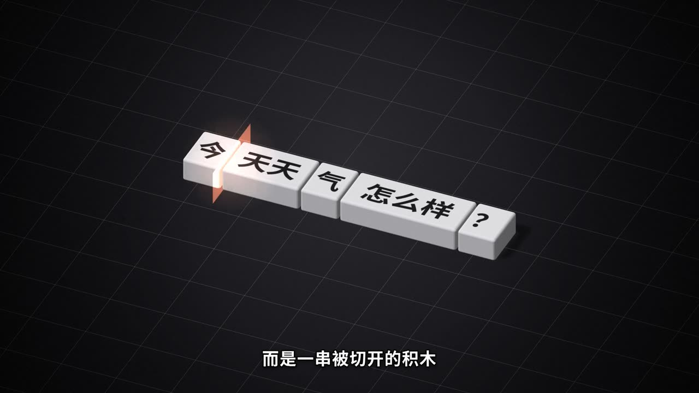
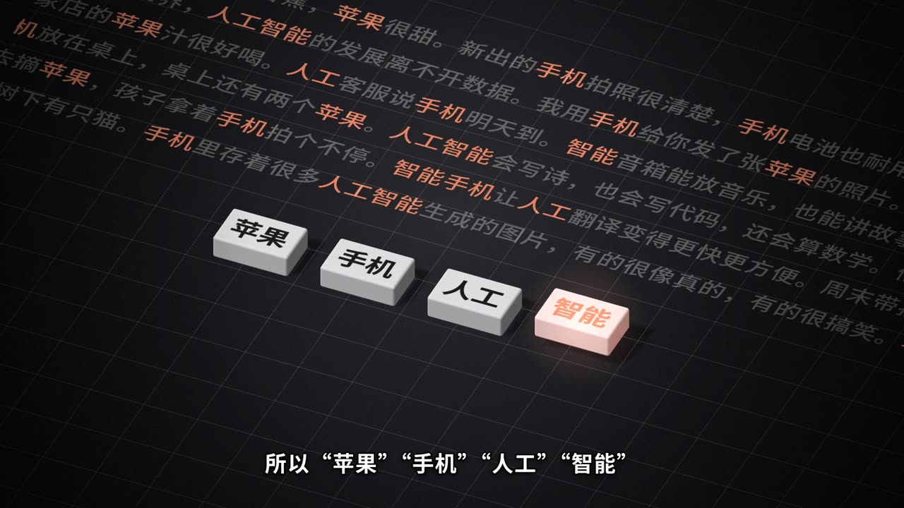
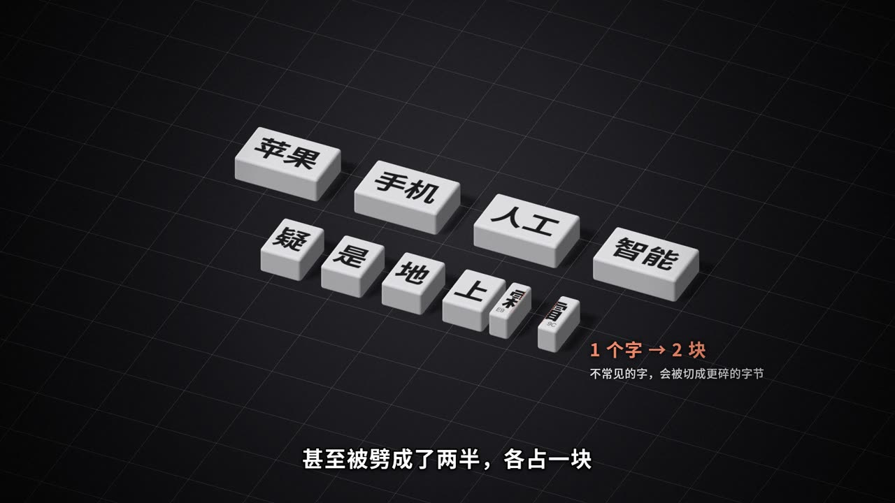
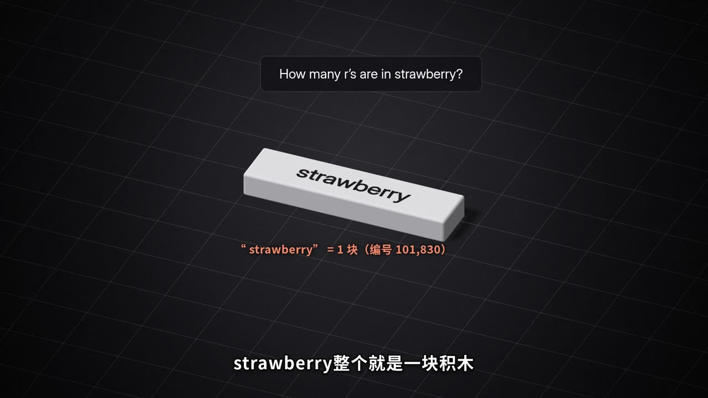
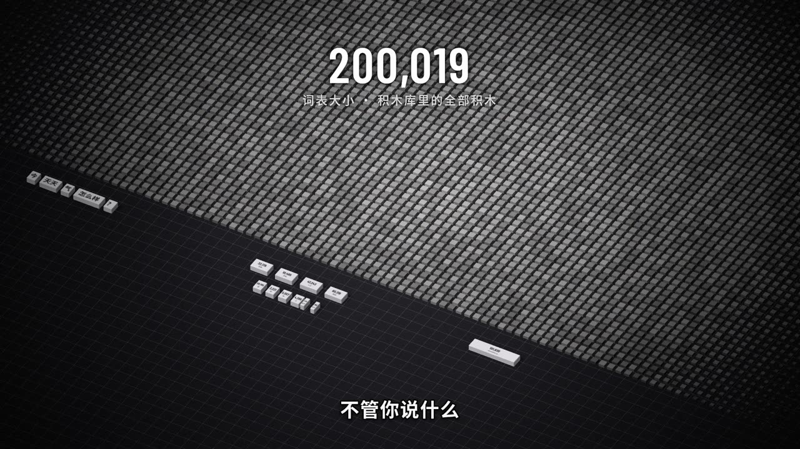
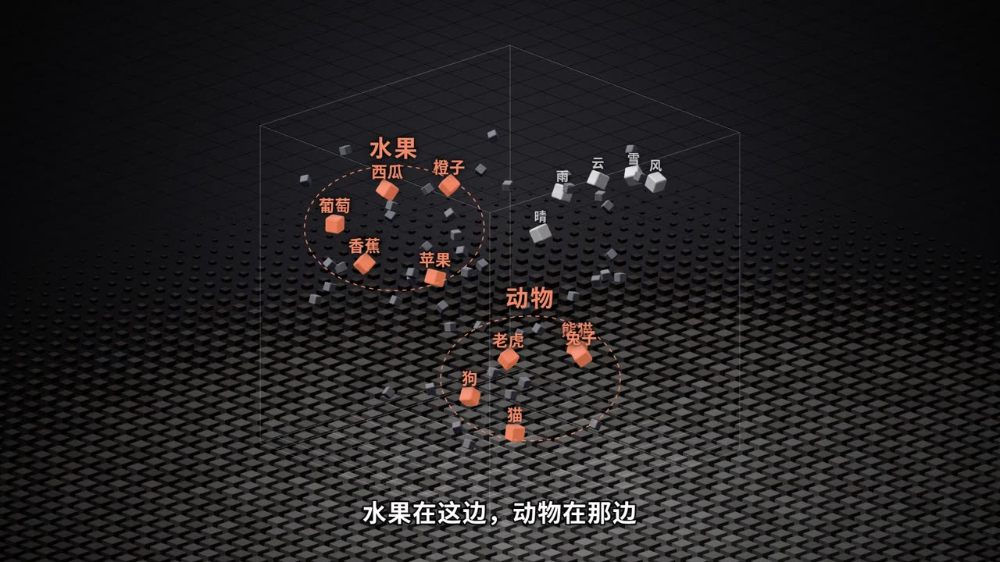
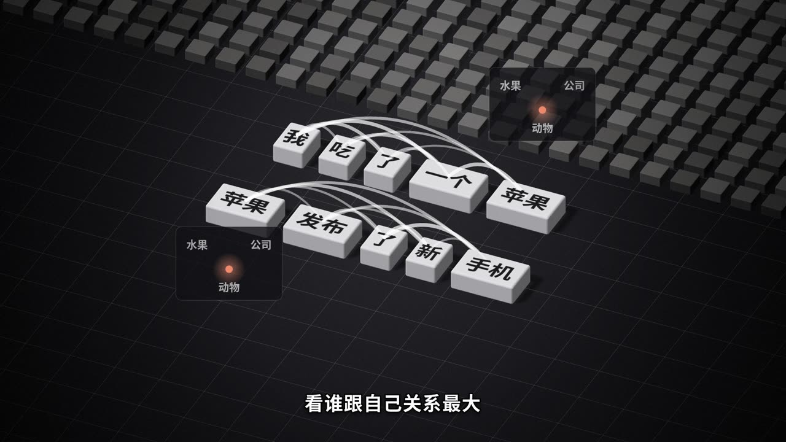
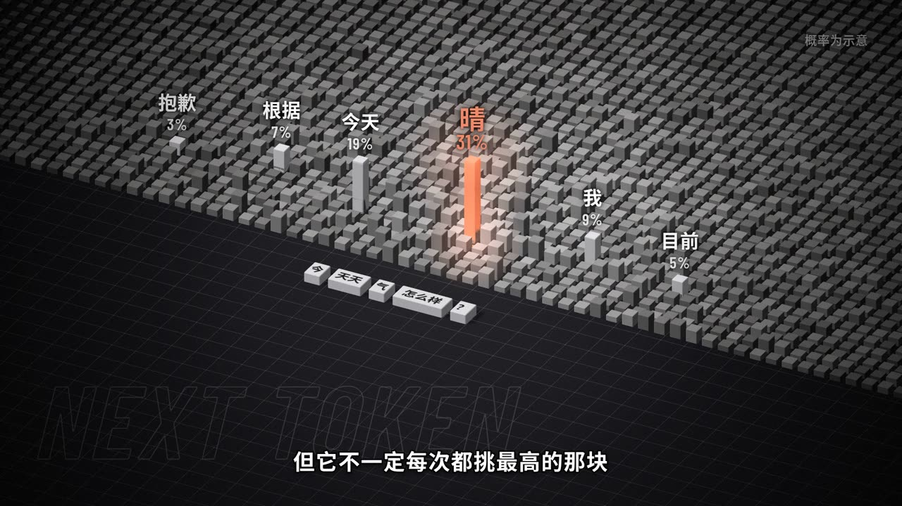

# kepu-film-skill · 科普原理片制作 Skill

**中文** | [English](#english)

让 AI Agent（Claude Code、Codex、WorkBuddy 等支持 Skill 的工具）**用代码从零做出一条 3–5 分钟的中文科普原理片**：脚本、配音、3D 动画、字幕、音效、配乐、封面，一条命令链跑完。

第一种风格是 **blockwise（积木）**：深灰底、白色哑光积木、单一珊瑚橙强调色，等轴测视角一镜到底。用它做出的范例片是《你天天说的 Token，到底是什么？》，完整源码在 `examples/token/`。

> 画面全部是代码逐帧生成的，没有 AI 生图，也没有素材库。每一帧都是时间的纯函数，所以能和配音精确对齐，也能分段渲染、断点续跑。

## 范例片：《你天天说的 Token，到底是什么？》


3 分 40 秒，从脚本、3D 画面、动画代码到渲染和混音，全部由 Claude Opus 5.5 用这套方法独立完成。下面是片中的几个画面：

| | | |
|---|---|---|
| <br>“今天天气怎么样？”被切成“今 / 天天 / 气 / 怎么样” | <br>经常一起出现的字被粘成一块 | <br>不常见的“霜”字被劈成两半 |
| <br>strawberry 整个就是一块积木，所以 AI 数不清 r | <br>词表：二十万块积木 | <br>意思空间：意思相近的积木靠在一起 |
| <br>注意力：每块积木回头看前面所有积木 | <br>给候选积木打分，按概率抽一块 | <br>在二十万块积木里，一块一块地接龙 |

4:3 封面（用于小红书、视频号等）：


## 能做什么样的片子

- ✅ 讲一个看不见的机制：AI 原理（Token、注意力、RAG、MoE……）、计算机原理、金融机制等
- ✅ 冷静的旁白解说，一个视觉比喻贯穿全片，横屏 1080p，3–5 分钟
- ❌ 拆解实物（需要写实建模）、剧情片、真人出镜、数据新闻图表

## 安装

把整个仓库放进你的 Agent 的 skills 目录：

```bash
# Claude Code
git clone https://github.com/oldduck123/kepu-film-skill ~/.claude/skills/kepu-film
# Codex
git clone https://github.com/oldduck123/kepu-film-skill ~/.codex/skills/kepu-film
# 其他工具：放到它的 Skill 目录，或者直接让 Agent 读 SKILL.md
```

然后安装依赖（只需一次）：

```bash
cd ~/.claude/skills/kepu-film/engine && bun install
bash ../scripts/fetch_fonts.sh                    # 下载开源字体（约 26 MB）
pip install numpy scipy soundfile librosa edge-tts
```

**需要的环境**：Node 18+、[Bun](https://bun.sh)、Python 3.10+、ffmpeg、Chrome 或 Chromium（无头渲染用，不需要显卡）。

## 用法

直接对 Agent 说：

> 用 kepu-film 做一条 3 分钟的片子，讲 RAG 是怎么让 AI 读你的文件的。

Agent 会照 `SKILL.md` 的流程：定钩子 → 写脚本给你确认 → 配音 → 先出 30 秒样片给你看 → 全片渲染 → 混音 → 成片 + 封面 → 质检。

## 付费接口（可选）

| 用途 | 服务 | 没有的话 |
|---|---|---|
| 配音 | **MiniMax 语音合成**，国内站 [platform.minimaxi.com](https://platform.minimaxi.com)，按字数计费 | 用免费的 Edge TTS（`scripts/tts_edge.py`），听感平一些 |
| 配乐 | **Suno 国内站** [suno.cn](https://www.suno.cn)，配合官方的 Agent skill「Suno.cn AI 音乐助手」，网页登录授权 | 不加配乐，或者自己提供免版权音乐 |

调用逻辑、参数和范例里实际用过的提示词都在 [`references/apis.md`](references/apis.md)。API key 只通过环境变量传入，**不要写进任何文件**。

## 目录

```
SKILL.md                      Agent 读的主文件：适用范围、环境、流程、硬规则
references/
  styles/blockwise.md         积木风格规范：色彩、镜头、积木、叠层、字幕、节奏、封面、禁忌
  narrative.md                叙事模板和写脚本的方法
  workflow.md                 每一步的命令、产物和检查点
  engine.md                   引擎接口
  apis.md                     MiniMax / Suno / 免费替代方案
  qc.md                       质检清单和踩过的坑
engine/                       渲染引擎（three.js + Vite + Playwright）
scripts/                      配音、时间轴、分段渲染、混音、成片、联系表
templates/blockwise/          可以直接跑通的起步模板（约 28 秒）
examples/token/               完整范例片的脚本、数据和全部画面代码
docs/images/                  范例片截图和封面
```

## 快速试跑模板

```bash
K=~/.claude/skills/kepu-film
cp -r $K/templates/blockwise ~/films/demo
python3 $K/scripts/tts_edge.py ~/films/demo           # 免费配音
python3 $K/scripts/build_timeline.py ~/films/demo
PORT=5190 bash $K/scripts/render_chunks.sh ~/films/demo 10
python3 $K/scripts/mix.py ~/films/demo
bash $K/scripts/finalize.sh ~/films/demo demo         # → ~/films/demo/out/demo.mp4
```

## 说明

- 做出来的效果很依赖 Agent 用的模型：画面代码每条片子都要现写，模型越强，越接近范例的质量。
- 软件渲染约 1.5 秒一帧，一条 3.5 分钟的片子要渲染约 3 小时。
- 字体使用 SIL OFL 开源授权（思源黑体、Barlow Condensed、Inter）；音效全部由代码合成；仓库里不包含任何付费生成的音频。
- 代码以 MIT 协议开源。用它做出来的片子，版权归你。

欢迎提交新的风格（参考 `references/styles/README.md`）。

---

<a id="english"></a>

# kepu-film-skill · Science Explainer Film Skill

[中文](#kepu-film-skill--科普原理片制作-skill) | **English**

An agent skill (Claude Code, Codex, WorkBuddy, or any tool that supports skills) for **making a 3–5 minute Chinese science explainer film entirely from code**: script, narration, 3D animation, subtitles, sound effects, music and cover, in one pipeline.

The first visual style is **blockwise**: a dark grey world, matte white blocks, one coral accent colour, an isometric camera and a single continuous shot with no cuts. The sample film made with it, *What exactly is the "Token" you hear about every day?*, is included with full source in `examples/token/`.

> Every frame is generated by code: no AI image generation and no stock footage. Each frame is a pure function of time, so visuals sync exactly to the narration, and rendering can be split into chunks and resumed after a crash.

## Sample film: *What exactly is the "Token" you hear about every day?*


3 min 40 s. Script, 3D visuals, animation code, rendering and mixing were all done by Claude Opus 5.5 using this method. Stills from the film:

| | | |
|---|---|---|
| <br>"今天天气怎么样？" is cut into 今 / 天天 / 气 / 怎么样 | <br>Characters that often appear together get glued into one block | <br>A rare character, 霜, gets split in two |
| <br>"strawberry" is a single block, so the model can't count its r's | <br>The vocabulary: 200,000 blocks | <br>Meaning space: similar blocks sit close together |
| <br>Attention: every block looks back at all the blocks before it | <br>Candidates get scores; one is sampled by probability | <br>One block at a time, out of 200,000 |

## What it is for

- ✅ Explaining an invisible mechanism: AI concepts (tokens, attention, RAG, MoE…), computing, finance mechanisms
- ✅ Calm voice-over, one visual metaphor carried through the whole film, landscape 1080p, 3–5 minutes
- ❌ Teardowns of physical products (needs realistic modelling), drama, on-camera presenters, data-journalism charts

## Install

Clone the repo into your agent's skills directory:

```bash
# Claude Code
git clone https://github.com/oldduck123/kepu-film-skill ~/.claude/skills/kepu-film
# Codex
git clone https://github.com/oldduck123/kepu-film-skill ~/.codex/skills/kepu-film
# Other tools: put it in their skills directory, or point the agent at SKILL.md
```

Then install dependencies (once):

```bash
cd ~/.claude/skills/kepu-film/engine && bun install
bash ../scripts/fetch_fonts.sh                    # open-licensed fonts, about 26 MB
pip install numpy scipy soundfile librosa edge-tts
```

**Requirements**: Node 18+, [Bun](https://bun.sh), Python 3.10+, ffmpeg, Chrome or Chromium (headless rendering; no GPU needed).

## Usage

Just ask your agent:

> Use kepu-film to make a 3-minute film explaining how RAG lets an AI read your files.

The agent follows `SKILL.md`: pick a hook → write the script and show you → narration → a 30-second sample for your approval → full render → mix → final film + cover → quality check.

## Paid services (optional)

| Purpose | Service | Without it |
|---|---|---|
| Narration | **MiniMax TTS**: China site [platform.minimaxi.com](https://platform.minimaxi.com), international [minimax.io](https://www.minimax.io); billed per character | Free Edge TTS (`scripts/tts_edge.py`), flatter delivery |
| Music | **Suno China site** [suno.cn](https://www.suno.cn), via its official agent skill "Suno.cn AI 音乐助手", authorised by web login | No music, or bring your own royalty-free tracks |

Request formats, parameters and the prompts used for the sample film are in [`references/apis.md`](references/apis.md) (Chinese). API keys are passed only as environment variables; **never write them into any file**.

## Layout

```
SKILL.md                      main file the agent reads: scope, requirements, workflow, hard rules
references/
  styles/blockwise.md         blockwise style spec: colour, camera, blocks, overlays, subtitles, pacing, cover, don'ts
  narrative.md                story structure and how to write the script
  workflow.md                 commands, outputs and checkpoints for each step
  engine.md                   engine API
  apis.md                     MiniMax / Suno / free alternatives
  qc.md                       QC checklist and known pitfalls
engine/                       render engine (three.js + Vite + Playwright)
scripts/                      narration, timeline, chunked render, mix, finalize, contact sheets
templates/blockwise/          starter template that renders as-is (about 28 s)
examples/token/               script, data and full scene code of the sample film
docs/images/                  stills and covers of the sample film
```

The docs are written in Chinese, since the films are Chinese-language; modern agents read them fine whatever language you talk to them in.

## Try the template

```bash
K=~/.claude/skills/kepu-film
cp -r $K/templates/blockwise ~/films/demo
python3 $K/scripts/tts_edge.py ~/films/demo           # free narration
python3 $K/scripts/build_timeline.py ~/films/demo
PORT=5190 bash $K/scripts/render_chunks.sh ~/films/demo 10
python3 $K/scripts/mix.py ~/films/demo
bash $K/scripts/finalize.sh ~/films/demo demo         # -> ~/films/demo/out/demo.mp4
```

## Notes

- Results depend heavily on the agent's model: the scene code is written fresh for every film, so stronger models get closer to the sample's quality.
- Software rendering runs at about 1.5 s per frame; a 3.5-minute film takes about 3 hours.
- Fonts are SIL OFL (Noto Sans SC, Barlow Condensed, Inter); all sound effects are synthesised in code; the repo contains no paid-generated audio.
- Code is MIT licensed. Films you make with it are yours.

New styles are welcome (see `references/styles/README.md`).
